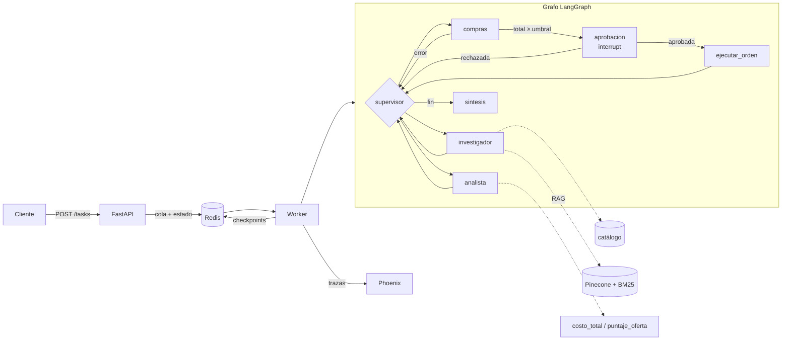

# Sistema de compras multi-agente

Proyecto final de AI Engineering. Un equipo de agentes (LangGraph) resuelve pedidos de compra de una tienda de tecnología: busca ofertas en el catálogo, consulta la base documental interna con RAG (política de compras, condiciones de proveedores, ventas, devoluciones), compara costos y genera la orden. Las órdenes de más de $500.000 se frenan hasta que una persona las aprueba.

La API (FastAPI) no ejecuta el grafo: encola la tarea en Redis y devuelve un `job_id`. Un worker aparte la procesa, guarda los checkpoints de LangGraph en Redis y manda las trazas a Arize Phoenix.



| Capa | Dónde |
|---|---|
| LLM (Gemini, async, rate limiter compartido) | `app/graph.py` |
| RAG híbrido: BM25 + Pinecone fusionados con RRF | `app/rag.py`, documentos en `data/docs/` |
| Supervisor y especialistas | `app/graph.py`, herramientas en `app/tools.py` |
| Human-in-the-loop | `app/hitl.py` |
| API y contratos Pydantic | `app/main.py`, `app/schemas.py` |
| Cola, estado de jobs y worker | `app/jobs.py`, `app/worker.py` |
| Trazas (OpenInference → Phoenix) | `app/observability.py` |

Algunas decisiones:
- **Supervisor jerárquico**: el supervisor solo decide quién trabaja; cada especialista recibe la instrucción y el contexto que necesita, no todo el historial. Hay un tope de pasos para que no quede en loop.
- **Los montos no salen del LLM**: el nodo de compras extrae proveedor, producto y cantidad, y el total se recalcula con el catálogo antes de pedir aprobación.
- **RAG híbrido**: BM25 encuentra nombres exactos de proveedores y la búsqueda vectorial las paráfrasis. Se combinan posiciones (RRF), no puntajes. La primera vez que arranca, el worker crea el índice y sube los documentos.
- **Estados del job**: `PENDING → RUNNING → (WAITING_APPROVAL) → DONE | FAILED`. Cualquier excepción o timeout deja el job en `FAILED` con el error.

## Levantar

Requiere Docker y claves de Gemini y Pinecone.

```bash
cp .env.example .env      # completar GEMINI_API_KEY y PINECONE_API_KEY
docker compose up --build
```

API en http://localhost:8000/docs y Phoenix en http://localhost:6006.

| Método | Ruta | |
|---|---|---|
| POST | `/tasks` | `{"consulta": "...", "thread_id": opcional}` |
| GET | `/tasks/{id}` | estado, resultado u orden pendiente |
| POST | `/tasks/{id}/approve` | `{"aprobado": true, "comentario": "..."}` |
| GET | `/ordenes` | órdenes ejecutadas |

Con el mismo `thread_id` la conversación continúa, también después de reiniciar los contenedores.

## Pruebas

```bash
pip install -r requirements.txt
python scripts/prueba_carga.py --aprobar   # 5 consultas concurrentes contra la API
pytest                                     # tests sin red
```

Las capturas de las trazas en Phoenix están en [`screenshots/`](screenshots).
